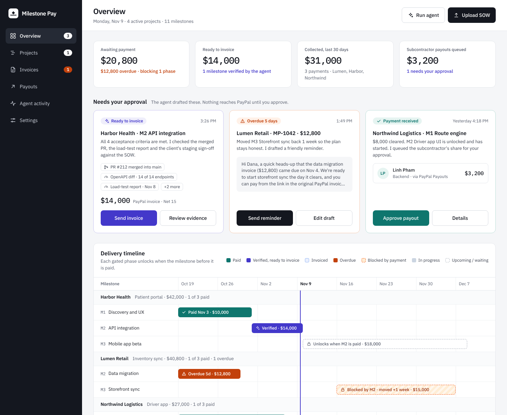

# Milestone Pay

**AI-run milestone billing for software agencies, built on PayPal.**

Agencies that deliver fixed-fee projects get paid by milestone. In practice that means someone reads the statement of work, chases evidence that a milestone is really done, raises the invoice, follows up when it's late, quietly lets the next phase slip, and finally pays the subcontractors who did the work. Milestone Pay hands that loop to an agent and keeps a person in charge of every step that moves money.



## What it does

| Step | Agent (Claude) | PayPal |
| --- | --- | --- |
| **Read the SOW** | Turns an uploaded SOW (PDF or text) into milestones, amounts, dates and acceptance criteria, cites the page for each, and flags anything it can't verify, with a measurable rewrite to accept or reject. | Prepares one invoice per milestone. |
| **Verify delivery** | Checks the team's evidence (PRs, test reports, CI runs, client emails) against each acceptance criterion and explains every verdict. | When all criteria are met, the invoice waits for your approval. |
| **Get paid** | — | Creates and sends the invoice through **PayPal Invoicing**. The client pays by PayPal or card. |
| **React to payment** | Unlocks the next phase on the timeline and queues subcontractor shares. | The **`INVOICING.INVOICE.PAID` webhook** (signature-verified) triggers the update. |
| **Chase late payments** | Moves blocked phases back so the plan stays honest and drafts a friendly reminder. | Sends the reminder through PayPal's **invoice reminder** API. |
| **Pay the team** | — | Pays subcontractors with **PayPal Payouts** after the client's money clears, then confirms through payout webhooks. |

Nothing reaches PayPal until you approve it on the **Needs your approval** queue.

## Run it locally (no keys needed)

Requirements: Node.js 20.9 or newer (22 recommended).

```bash
npm install
npm run dev
```

Open http://localhost:3000. With no environment variables the app runs fully offline:

- **Mock PayPal**: realistic invoice and payout ids, and payments are simulated.
- **Mock AI**: deterministic results. Any SOW upload returns the sample Pinecrest extraction.
- **Mock data**: four active projects and one SOW draft, all dated relative to today. Data lives in memory and resets on restart, or from **Settings → Reset demo data**.

### Try the whole loop in two minutes

1. **Overview**: Harbor Health M2 is verified. Click **Send invoice**.
2. In **Invoices**, click **Simulate payment** on the new invoice. M3 unlocks and Minh Le's share appears for approval.
3. Click **Approve payout**.
4. Lumen Retail's invoice is 5 days overdue, so its next phase was pushed back a week. **Send reminder** sends the drafted reminder.
5. **Upload SOW → Use the sample SOW**. Accept the agent's fix for the vague performance clause, set payment terms, toggle a payment gate and **Create project**.
6. Open **Northwind M2 (Driver app UI)**, add evidence and click **Mark done and run the check**.

## Connect the PayPal sandbox

1. Sign in at the [PayPal Developer Dashboard](https://developer.paypal.com/dashboard/) and create a **sandbox** app. Copy its client id and secret.
2. Under **Testing Tools → Sandbox Accounts**, create (or reuse) a **Personal** account for the client and another for a subcontractor.
3. Create `.env.local`:

   ```bash
   PAYPAL_CLIENT_ID=...
   PAYPAL_CLIENT_SECRET=...
   DEMO_CLIENT_EMAIL=buyer-sandbox@example.com    # every invoice goes here
   DEMO_PAYOUT_EMAIL=payee-sandbox@example.com    # every payout goes here
   ```

4. **Webhooks.** PayPal must be able to reach your app, so deploy first (or tunnel localhost with ngrok or cloudflared). In your sandbox app, add a webhook for `https://<your-app>/api/paypal/webhook` with these events:
   `INVOICING.INVOICE.PAID`, `INVOICING.INVOICE.CANCELLED`, `PAYMENT.PAYOUTSBATCH.SUCCESS`, `PAYMENT.PAYOUTSBATCH.DENIED`, `PAYMENT.PAYOUTS-ITEM.SUCCEEDED`, `PAYMENT.PAYOUTS-ITEM.FAILED`.
   Copy the webhook id into `PAYPAL_WEBHOOK_ID`. Every incoming event is verified with `POST /v1/notifications/verify-webhook-signature` before it's applied.
5. Restart the app. The sidebar shows **PayPal sandbox connected**, and **Settings** shows the exact webhook URL.

To pay an invoice for real in the sandbox, open **PayPal invoice** from the Invoices table and pay as the sandbox buyer. **Simulate payment** records an external payment through the Invoicing API instead, which fires the same PAID webhook.

> Seeded mock invoices have no PayPal id, so reminders and simulated payments for those stay local. New invoices you send are real sandbox invoices.

## Connect Claude

```bash
ANTHROPIC_API_KEY=sk-ant-...
ANTHROPIC_MODEL=claude-sonnet-5-5   # optional
```

The agent uses Claude's **structured outputs** (`messages.parse` with Zod schemas), so every response is validated before the app acts on it. PDFs go to Claude as document blocks, so no PDF parsing library is involved. Test files are in [`samples/`](samples/).

## Keep data between restarts

Set `DATABASE_URL` to any Postgres database. The free tiers of Neon, Supabase and Vercel Postgres all work; use the pooled connection string on serverless hosts. On first run the app creates one table, `milestone_pay_state`, and seeds it.

## Deploy

**Vercel**: import the GitHub repo, add the environment variables from `.env.example`, and deploy. `vercel.json` schedules a daily agent sweep (`/api/agent/sweep`). Set `CRON_SECRET` to protect that endpoint.

**Netlify**: import the repo; `netlify.toml` already sets the build. Netlify runs Next.js through its own runtime. There's no scheduled sweep on Netlify; use **Run agent** in the app or call `POST /api/agent/sweep` from any scheduler.

On either host, set `DATABASE_URL` for the hosted demo. Otherwise each serverless instance has its own in-memory copy of the data.

## How it's built

- **Next.js 16** (App Router, Cache Components, Server Actions), **React 19**, **TypeScript**, **Tailwind CSS 4**
- **PayPal REST APIs**: OAuth 2.0, Invoicing v2 (create, send, remind, record payment), Payouts v1, Webhooks (signature verification)
- **Claude** via `@anthropic-ai/sdk` with structured outputs
- **Postgres** (optional) via `postgres`
- **Vitest** for the business rules and agent workflows

```
src/
  app/                    routes, server actions (actions.ts) and API routes
    api/paypal/webhook/   PayPal webhook receiver (verified)
    api/sow/              SOW upload → draft project
    api/agent/sweep/      daily agent run (overdue shifts, reminder drafts)
  components/             UI: dashboard, timeline, projects, milestones
  lib/
    agent/                workflows: what the agent does and when it asks you
    ai/                   Claude client, prompts, Zod schemas, mock
    paypal/               sandbox REST client, mock, shared types
    domain/               pure business rules (gates, overdue shifts, KPIs)
    store/                in-memory and Postgres state stores
  data/                   seed (mock) data and the sample SOW
samples/                  sample SOW (PDF, Markdown) and a webhook payload
tests/                    Vitest suites
```

Each integration sits behind an interface (`PaypalGateway`, `AiGateway`, `Store`) with a real and a mock implementation, chosen by environment variables. The delivery timeline is one self-contained component (`DeliveryTimeline`), so it can be swapped for a Gantt library such as Bryntum without touching the rest of the app.

## Scripts

| Command | What it does |
| --- | --- |
| `npm run dev` | Start the dev server |
| `npm run build` / `npm start` | Production build and server |
| `npm test` | Run the Vitest suites |
| `npm run lint` | ESLint |
| `npm run typecheck` | Generate route types and run `tsc` |

## Notes and limits

- **Single-user demo.** There's no sign-in, so anyone who can reach a deployment can press its buttons. Only use sandbox credentials.
- **Untrusted documents.** SOW text and evidence are passed to Claude as data, and the prompts tell it never to follow instructions inside them. The agent's output is schema-validated and only ever proposes actions; a person approves anything that moves money.
- **PayPal limits.** PayPal allows two invoice reminders per invoice per day, and Payouts must be enabled on the sandbox business account (it is by default).

## License

[MIT](LICENSE)
